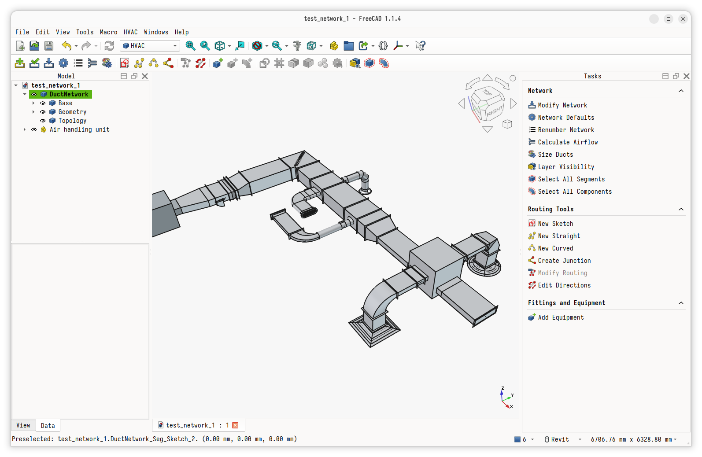
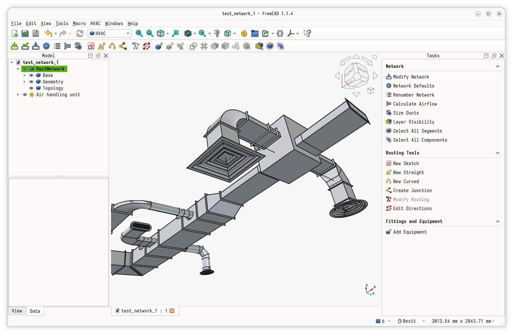
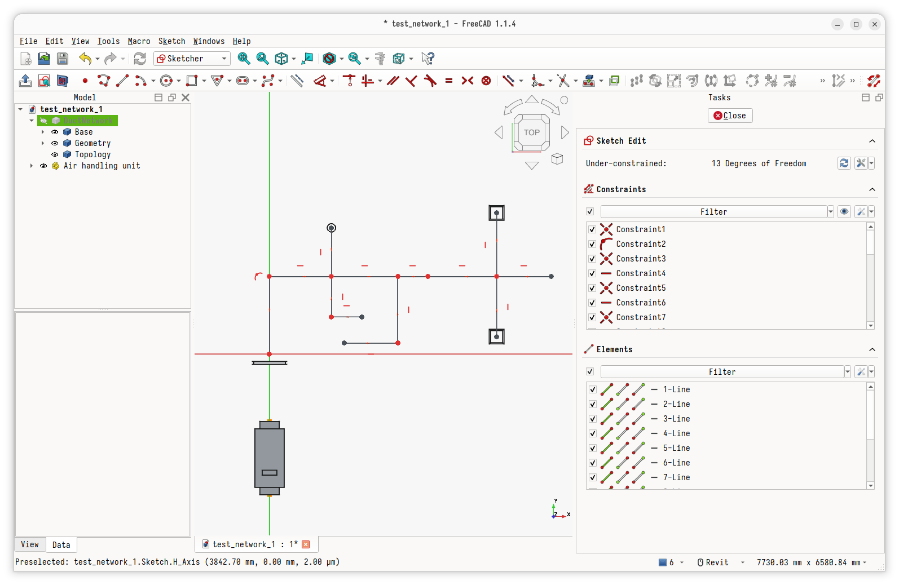
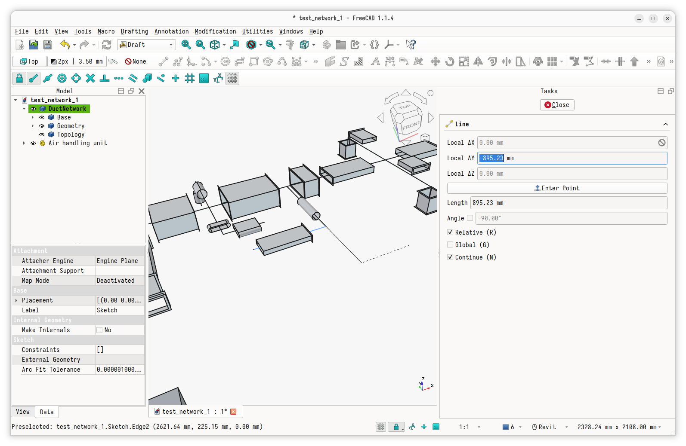
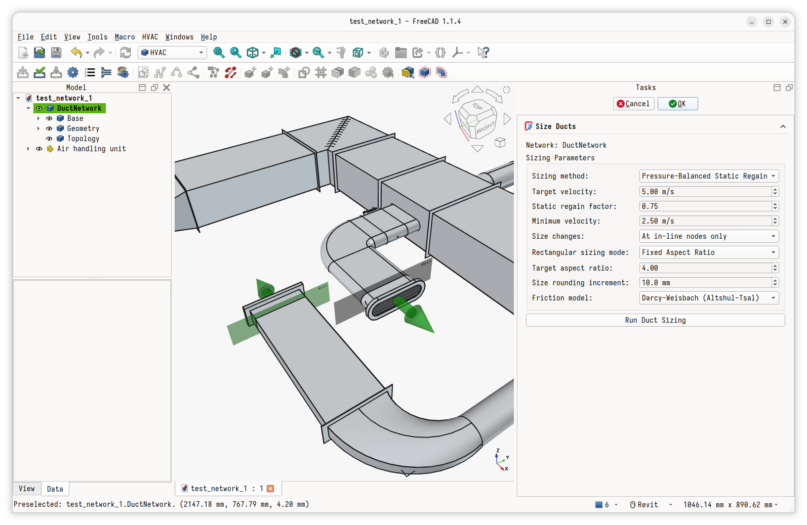
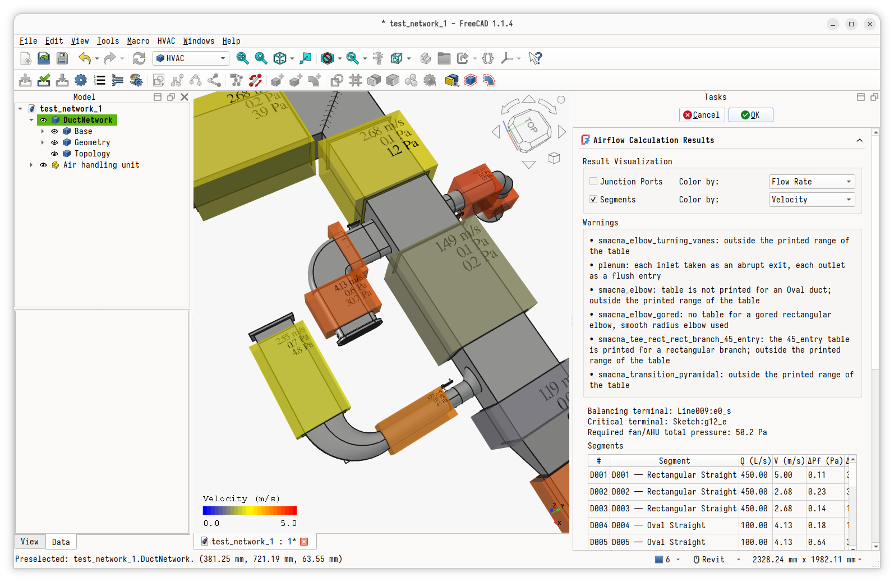
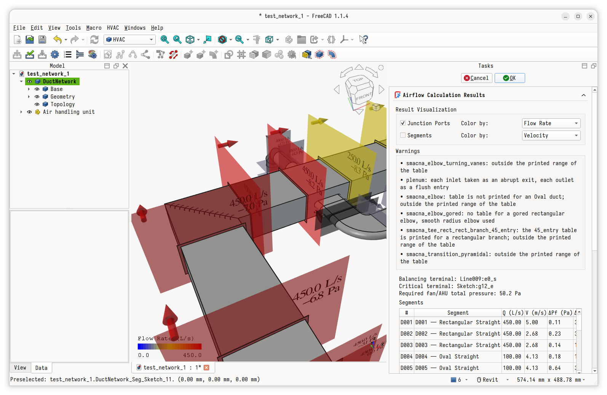
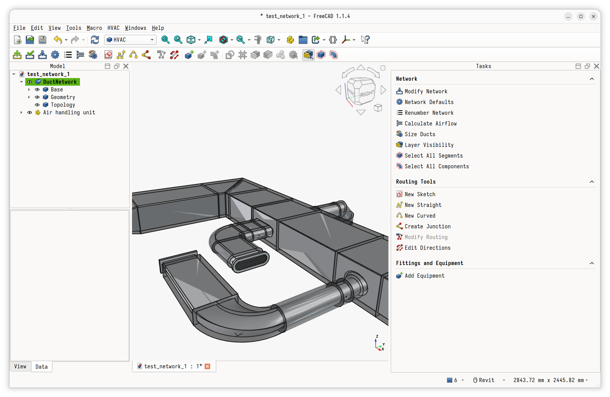

# FreeCAD-HVAC

FreeCAD-HVAC is a FreeCAD workbench for designing HVAC duct networks. You draw the duct routes; the workbench works
out how they connect, builds the ducts and fittings from a library, calculates airflow and pressure drop, and sizes
the ducts.

Requires FreeCAD 1.0 or later (developed and tested on FreeCAD 1.1). The software is alpha: documents and libraries
made with an earlier version may need to be rebuilt (see [`CHANGELOG.md`](CHANGELOG.md)).

## Workflow

1. **Create Network** and set its system type (Supply, Return, Exhaust or Outdoor air). One network is one system.
2. Draw the routes with sketches, lines or curves (**New Sketch**, **New Straight**, **New Curved**).
3. The workbench parses the routes into ducts and junctions, picks a fitting for each junction from the network's
   library, and builds the geometry. Editing a route later updates the ducts and fittings that depend on it.
4. Change what you need: sizes and parameters in the property editor, the fitting or duct type with **Edit Type**,
   dampers and other in-line devices with **Edit Inline Components**, materials with **Edit Material**, and the
   air direction with **Edit Directions**.
5. Connect equipment: **Add Equipment** places an air handling unit or fan from a library; **Create Custom
   Equipment** and **Create Custom Fitting** turn your own model into equipment or a fitting with ports. A duct drawn
   to end on a port connects to it.
6. Set the design flow at each terminal, then run **Calculate Airflow** and **Size Ducts**. Results show in the 3D
   view and in tables you can export to a spreadsheet.

## Features

**Ducts and fittings**
- Round, rectangular and oval ducts, straight, curved and flexible.
- Fittings for every kind of junction: elbows (radius, mitered, with turning or splitter vanes), offsets,
  transitions, tees, wyes, lateral tees, taps (straight, saddle, shoe; side- or face-mounted), crosses, double
  wyes and plenums.
- Terminals: diffusers, grilles and registers with a drawn face, entries, exits, hoods, end caps, and the
  connection to equipment.
- In-line devices: dampers (with blades and an operator), fire dampers, VAV boxes, silencers, filters, coils,
  access doors and flexible connectors.
- Each duct and fitting is built from construction layers (sheet-metal wall, insulation), each with its own
  material from FreeCAD's material database, and features such as flanges. Layers and features can be hidden with
  **Layer Visibility**.
- A fitting that cannot be built is drawn as a marker, and its `GeometryError` property says why.

**Analysis**
- Airflow in every duct from the terminal design flows, pressure drop of every duct and fitting, pressure along
  each path, the critical path, and the balancing each path needs.
- Fitting losses from the SMACNA HVAC Systems Duct Design loss tables (14-9 to 14-18), all digitised. A lookup
  outside the printed range is reported as an approximation. See [loss coverage](docs/loss-coverage.md).
- Duct sizing by constant velocity, constant friction rate or static regain, with per-duct overrides. By default
  the size changes only at straight-through junctions, and the sizer suggests where to add reducers.
- Friction by Darcy-Weisbach (Altshul-Tsal or Colebrook), a CSV chart or a formula; duct roughness comes from the
  wall material.

**Libraries**

Ducts and fittings come from libraries of type definitions, not from code in the workbench. Three libraries ship:

- `smacna`: sheet-metal types with walls, insulation and flanges, for day-to-day modelling.
- `builtin_basic`: the same set of types in a simpler build.
- `samples`: examples of the other ways a library can make geometry (PartScript, FCStd templates, BREP/STEP files).

New types, profiles and parameters are added as library data. See
[Writing an HVAC library](docs/library-guide.md), the [type-def reference](docs/type-def-reference.md) and the
[library API reference](docs/library-api.md).

## Screenshots

A supply network with an air handling unit, SMACNA fittings, terminals and in-line devices:

Terminals and fittings up close: a square ceiling diffuser, a round diffuser, a grille, a plenum and
flanged joints:

Routes drawn as a sketch or as Draft lines; the ducts and fittings follow the routes:

Size Ducts, here with pressure-balanced static regain:

Calculate Airflow results in the 3D view: velocity on the ducts, flow rate and pressure at the junction ports,
with warnings and result tables in the panel:

Layers, with insulation visible:

## Design goals

- [x] Duct routing from sketches, lines and curves.
- [x] Detailing of rectangular, round and oval ducts and fittings: construction layers, insulation, flanges.
- [x] Library of air-side components: diffusers, grilles, registers, dampers, intake and exhaust accessories, VAV
      boxes, AHUs and fans.
- [x] Pressure drop from terminal flow rates, with static pressure at every node.
- [x] Automatic sizing by constant friction, constant velocity and static regain.
- [ ] Fan curves and the fan's operating point.
- [ ] Duct leakage.
- [ ] Bill of quantities.
- [ ] Imperial units in the analysis.
- [ ] BIM data.
- [ ] Custom-profile ducts and duct supports.
- [ ] Looped networks, thermal and acoustic calculations.
- [ ] Piping.

## Known limitations

- Networks must be trees: looped networks are not solved.
- SMACNA tables 14-14 I to M (wyes with a 45 degree collar, conical main) are digitised, but no fitting builds those
  shapes yet. Crosses have no SMACNA table and use a decomposed loss, reported as an approximation.
- Static regain applies only where the sizing sections meet, not within a section.
- A radiussed offset given a length too short for its arcs is refused, with a message saying how long it must be.

## For developers

How the workbench is put together (module responsibilities, the sync and execute flow, the airflow and sizing
solvers, library type selection) is in [`ARCHITECTURE.md`](ARCHITECTURE.md). Coding and testing rules are in
[`AGENTS.md`](AGENTS.md). Unit tests: `python3 -m pytest -q tests` from the repository root.
